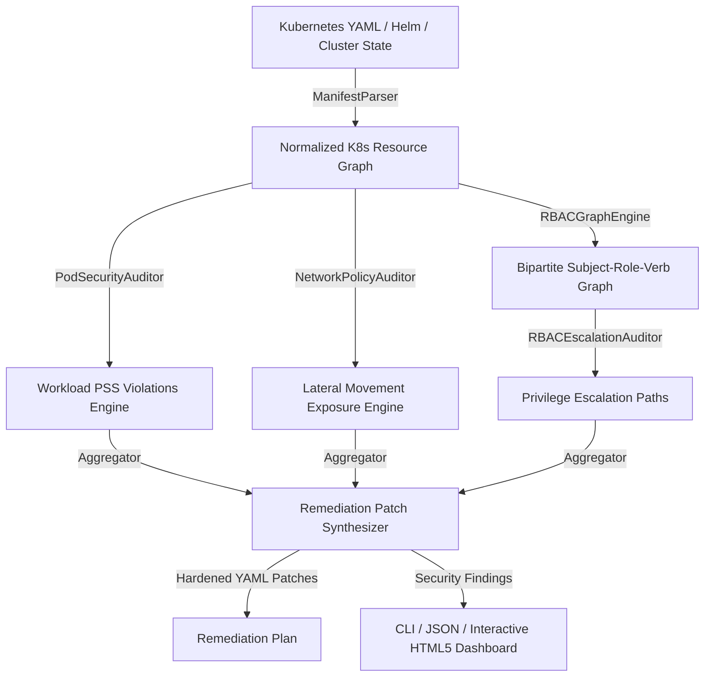

# KubeSentinel Architecture

## 1. Executive Summary
KubeSentinel is an Autonomous Cloud-Native Kubernetes Security Posture Management (KSPM) and RBAC Privilege Escalation Graph Auditor. It evaluates Kubernetes workload manifests, Helm templates, and RBAC policies against Pod Security Standards (PSS Restricted/Baseline), CIS Kubernetes Benchmark v1.8, and NSA/CISA Hardening Guidelines.

## 2. Architecture Diagram

## 3. Core Engine Components
- **`core/manifest_parser.py`**: Stream-parses multi-document Kubernetes YAML and JSON manifests, validating schema fields and separating workload resources (Pods, Deployments, StatefulSets, DaemonSets) from RBAC (Roles, ClusterRoles, Bindings) and Networking (NetworkPolicies).
- **`core/rbac_graph.py`**: Constructs a bipartite directed graph mapping ServiceAccounts, Users, and Groups to Roles and ClusterRoles through RoleBindings, computing transitive permission reachability.
- **`auditors/pod_security.py`**: Evaluates security contexts (`privileged`, `hostPID`, `hostNetwork`, `allowPrivilegeEscalation`, `runAsNonRoot`, `readOnlyRootFilesystem`, capability drops/adds).
- **`auditors/rbac_auditor.py`**: Traverses RBAC graph for high-risk escalation primitives (`bind`, `escalate`, `impersonate`, `secrets` read, `pods/exec`, wildcard `*`).
- **`auditors/network_policy.py`**: Audits namespaces for missing default-deny ingress/egress rules and isolated workloads.
- **`auditors/remediation_patcher.py`**: Generates drop-in hardened Kubernetes YAML manifests fixing detected security misconfigurations.
- **`reporters/`**: Formatted CLI summaries, JSON reports for CI/CD gates, and interactive HTML5 dashboards with compliance scorecards.
