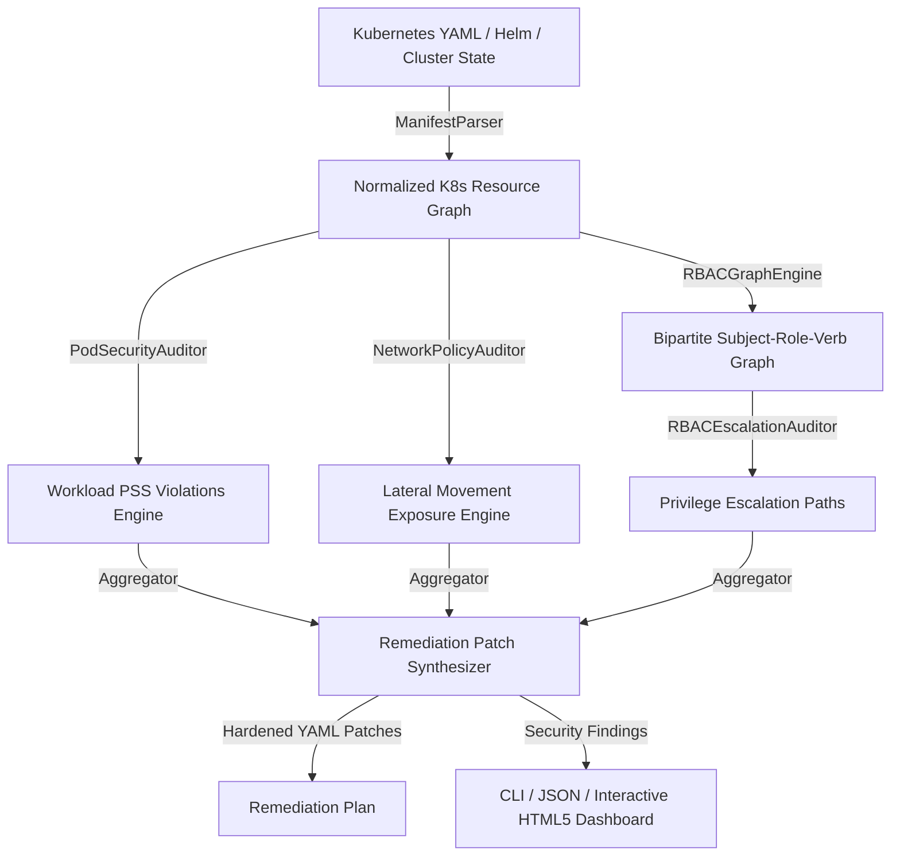

# KubeSentinel ☸️

> **Status:** prototype. A personal security-research project, not a production product. Expect rough edges; issues and pull requests are welcome.

> **Autonomous Cloud-Native Kubernetes Security Posture Management & RBAC Privilege Escalation Graph Auditor**

KubeSentinel is a prototype Kubernetes Security Posture Management (KSPM) and RBAC privilege graph auditor. It evaluates Kubernetes workload manifests, Helm chart outputs, and RBAC policies against Kubernetes Pod Security Standards (Restricted/Baseline), CIS Kubernetes Benchmark v1.8, and NSA/CISA Kubernetes Hardening Guidelines.

---

## 🌟 Key Capabilities

- **Multi-Document Manifest Stream Ingestion**: Parses stream YAML/JSON containing Deployments, DaemonSets, StatefulSets, Pods, Roles, ClusterRoles, RoleBindings, and NetworkPolicies.
- **Pod Security Standards (PSS) Compliance**: Flags:
  - 💥 `privileged: true` container breakout vectors.
  - 🚨 Host namespace sharing (`hostPID`, `hostNetwork`, `hostIPC`).
  - 🚨 Unrestricted privilege escalation (`allowPrivilegeEscalation: true`).
  - 🚨 Root execution risks (missing `runAsNonRoot: true`).
  - ⚠️ Writable root filesystems (missing `readOnlyRootFilesystem: true`).
  - ⚠️ Missing capability drops (missing `drop: ["ALL"]`).
  - 🚨 Dangerous capabilities (`CAP_SYS_ADMIN`, `CAP_NET_ADMIN`).
- **RBAC Privilege Escalation Graph**: Models subjects, bindings, and roles into a directed bipartite graph to detect:
  - 💥 Wildcard permissions (`*` verbs on `*` resources).
  - 💥 Self-escalation vectors (`bind` and `escalate` verbs on Roles and ClusterRoles).
  - 💥 Identity impersonation (`impersonate` on users, groups, or `system:masters`).
  - 🚨 Remote code execution via `pods/exec` create.
  - 🚨 Broad secret credential harvesting (`get`/`list` on `secrets`).
- **NetworkPolicy Isolation Auditing**: Detects namespaces containing active workloads that lack default-deny network policies, leaving pods open to unrestricted lateral movement.
- **Automated Remediation Patch Synthesizer**: Generates drop-in hardened Kubernetes YAML manifests fixing detected security misconfigurations.
- **Visual Dashboards & CI/CD Gate**: Produces terminal summaries, machine-readable JSON for DevSecOps, and standalone interactive HTML5 executive dashboards with build-breaking threshold gates (`--fail-on-severity HIGH`).

---

## 📐 Architecture



---

## 🚀 Quick Start

### 1. Installation

```bash
git clone https://github.com/csenta/kube-sentinel.git
cd kube-sentinel
pip install -r requirements.txt
```

### 2. Comprehensive Cluster Manifest Scan

```bash
python3 -m kube_sentinel.cli scan \
  --input examples/vulnerable_workload.yaml \
  --output-json report.json \
  --output-html report.html
```

### 3. Inspect RBAC Privilege Escalation Chains

```bash
python3 -m kube_sentinel.cli rbac \
  --input examples/rbac_escalation.yaml
```

Output:
```text
🔐 [KubeSentinel] RBAC Privilege Analysis for examples/rbac_escalation.yaml
======================================================================
  Active Roles:    1
  Active Bindings: 1
  Escalation Risks Detected: 3

[01] 🚨 CRITICAL | RBAC-002-BIND-ESCALATE | dev-operator-role
     Subject 'ServiceAccount/development/dev-sa' has 'bind' or 'escalate' verbs on (Cluster)Roles.
     Remedy: Remove 'bind' and 'escalate' verbs from non-admin service accounts.
```

### 4. Synthesize Hardened Kubernetes Manifests

```bash
python3 -m kube_sentinel.cli remediate \
  --input examples/vulnerable_workload.yaml \
  --output hardened.yaml
```

### 5. Enforce CI/CD Quality Gate

```bash
python3 -m kube_sentinel.cli scan \
  --input examples/vulnerable_workload.yaml \
  --fail-on-severity HIGH
```

---

## 🛠️ Testing

Run the test suite:

```bash
PYTHONPATH=. python3 -m unittest discover -s tests -v
```

---

## 🐳 Docker Deployment

Run with Docker Compose:

```bash
docker-compose up --build
```

## License

MIT. See [LICENSE](LICENSE).
